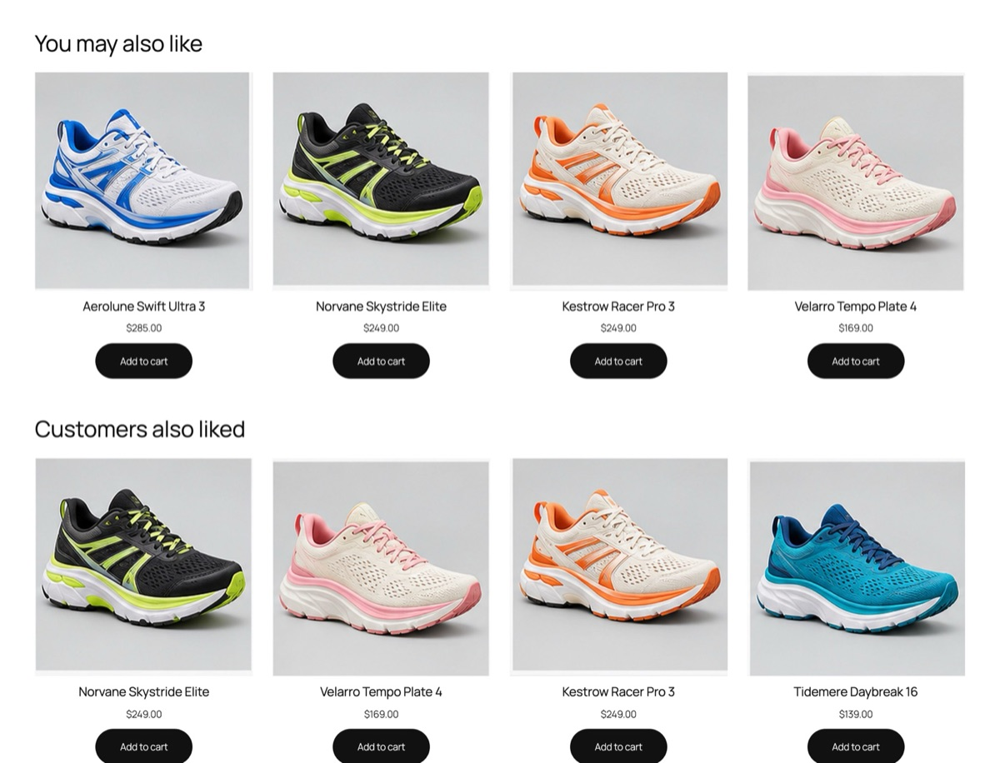

# LIKYLY for Laravel

Product recommendations in a Laravel app ("You may also like", "Trending now", "Frequently bought
together"), learned from what your visitors do. Your Eloquent catalog stays in sync by itself, a Blade
component shows the blocks, and impressions and clicks are tracked for you.



```sh
composer require likyly/laravel
php artisan likyly:install
```

Laravel 12 and 13, PHP 8.2 or later. Built on the [LIKYLY PHP SDK](https://packagist.org/packages/likyly/sdk).

## What `likyly:install` does

1. Writes your keys to `.env`: `LIKYLY_KEY` (public, `pk_...`), and `LIKYLY_SECRET_KEY` (secret, `sk_...`) to send the catalog.
2. Publishes `config/likyly.php`.
3. Finds your product model (`App\Models\Product`...), adds the `Recommendable` trait to it and lists it in the config.
4. Sends your whole catalog to LIKYLY.
5. Prints the Blade lines to paste.

Non-interactive (CI, scripts): `php artisan likyly:install --key=pk_... --secret=sk_... --model=Product --no-interaction`.

## Show a block

```blade
{{-- Product page: items similar to this one --}}
<x-likyly-recommendations placement="pdp-similar" :item="$product" title="You may also like" />

{{-- Home page: what is popular right now --}}
<x-likyly-recommendations placement="home-trending" title="Trending now" />
```

A placement (`pdp-similar`, `home-trending`...) is configured once in LIKYLY, by your coding assistant
through the LIKYLY MCP server or in the console: strategy, fallback, filters, how many items.

The component asks LIKYLY for the items, renders them **from your own models** (name, picture, link),
records the impressions, and sends clicks through `/likyly/click` before redirecting to the product.
An item that is no longer in your database is never shown. When LIKYLY has nothing or does not answer
within `likyly.timeout`, the block renders nothing and the page is unaffected.

Restyle it: `php artisan vendor:publish --tag=likyly-views`. Every item carries
`data-likyly-item-id`, the list `data-likyly-placement`.

## Your catalog

```php
use Likyly\Laravel\Recommendable;

class Product extends Model
{
    use Recommendable;

    // Optional: the product page (default: a route named products.show).
    public function likylyUrl(): ?string
    {
        return route('shop.product', [$this->category->slug, $this]);
    }
}
```

Every create, update and delete of a `Recommendable` model goes to LIKYLY. With `LIKYLY_QUEUE=true` it
goes through your queue instead of during the request. A LIKYLY outage never makes a save fail: it is
logged.

What LIKYLY receives is guessed from common column names (`name`/`title`, `description`, `category`,
`brand`, `price`, `image`...). To choose, override `toLikylyItem()`:

```php
public function toLikylyItem(): array
{
    return [
        'itemId' => $this->sku,
        'title' => $this->name,
        'description' => $this->description,
        'properties' => ['category' => $this->category->name, 'brand' => $this->brand, 'price' => $this->price, 'url' => $this->likylyUrl()],
    ];
}
```

Also available: `likylyImage()`, `likylyId()`, and `shouldSyncToLikyly()` to leave drafts out.

## Events

Anonymous visitors get an id in a first-party cookie (`likyly_sid`, one year) from a middleware the
package adds to the `web` group. Logged-in users are sent with their id too.

```php
use Likyly\Laravel\Facades\Likyly;

Likyly::view($product);
Likyly::addToCart($product, quantity: 2);
Likyly::purchase($product, orderId: $order->id, quantity: 2, price: 129.9, currency: 'EUR'); // replay-safe
Likyly::track('favorite', $product);                                                        // any event type

$recs = Likyly::recommend('cart-cross-sell', context: ['cartItemIds' => $cart->ids()]);     // your own rendering
```

## Commands

| Command | |
|---|---|
| `php artisan likyly:install` | keys, config, product model, first sync |
| `php artisan likyly:sync` | send the whole catalog again |
| `php artisan likyly:status` | check keys, API, catalog and blocks, and say what to fix |
| `php artisan likyly:uninstall` | remove the trait, the config and the keys (your LIKYLY account is not touched) |

## Configuration

`config/likyly.php`: `key`, `secret`, `catalog` (when your account has several catalogs), `base_url`,
`models`, `queue`, `timeout` (default 3 s), `cookie`, `click_path`.

## License

MIT
